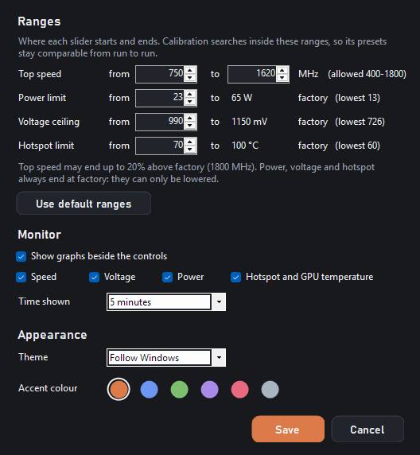

# Headroom

**Set a ceiling. The GPU stays under it.**

Headroom is a small Windows tool for Radeon GPUs whose tuning controls are hidden in AMD Software, which is
the usual situation on laptops. It gives you four ceilings (top speed, power, voltage, hotspot), applies them
in one click, and shows what the GPU really does afterwards, in numbers and as graphs.


## Why this exists

On laptop ("mobile") Radeon GPUs, recent versions of AMD Software show no manual tuning controls. On the
laptop this was developed on, the driver itself reports tuning as unsupported, so third-party overclocking
front-ends are locked out too.

The driver does still load a *power table* from the registry when it starts, and it obeys that table. This is
the same mechanism [MorePowerTool](https://www.igorslab.de/en/red-bios-editor-and-morepowertool-adjust-and-optimize-your-vbios-and-even-more-stable-overclocking-navi-unlimited/)
uses. Headroom edits four fields of that table, restarts the GPU so the driver reloads it, and lets you check
the result under load.

## What you get

- **Four ceilings on one screen.** Drag the stop to set a ceiling. The teal marker on the same rail shows the
  live reading, so you can see how much headroom is left.
- **Nothing changes until you apply.** While a stop is moved but not applied, a dashed ghost stays on the
  value the GPU is really running on, and one line lists every pending change as *applied → new*.
- **Monitor graphs** for speed, voltage, power, hotspot and GPU temperature, each with its applied limit drawn
  in. A flat line is stable; a line pressed against its limit is what holds the GPU back.
- **A load test, 20 seconds to 10 minutes,** that reports speed, voltage, power, hotspot peak and GPU
  temperature peak, compares them with the previous test or the factory baseline, and re-checks the GPU's
  calculations so an unstable setting shows up as a failed test. It always tests the applied settings.
- **Calibration** that benchmarks your GPU step by step and sets the Efficient and Boost presets from what it
  measured. See [Calibrating your GPU](#calibrating-your-gpu).
- **Your own ranges.** Settings decide where each slider starts and ends; calibration searches inside them.
- **Presets and profiles**: Factory, Cool, Efficient, Boost, plus any you save.
- **Guard rails.** Power, voltage and hotspot limit can only go *down* from your GPU's reference values.
- **No window needed:** `Headroom.exe --apply Cool` works from a shortcut or script.

## Will it work on my machine?

| | |
| --- | --- |
| Radeon RX 5500M (MSI Bravo 15 B5DD) | **Tested.** All four ceilings measured, see below. |
| Other RX 5000 series (5300M, 5500M in other laptops, 5600M, 5700M, desktop 5500 XT / 5600 XT / 5700) | **Untested.** Same table format, so Headroom runs and labels the model as untested. Please [report your result](docs/SUPPORTED-GPUS.md). |
| RX 6000 series | Not supported. Different table format; Headroom refuses it. |
| RX 7000 series and newer | Not supported. The driver no longer accepts registry tables. |
| Integrated Radeon graphics | Tuning not supported. The monitor graphs should still work. |
| Nvidia, Intel | Not supported. They have no equivalent of this table. Nvidia laptop GPUs can usually be tuned with MSI Afterburner. |

**Operating system:** Windows 10 version 2004 or newer, or Windows 11, 64-bit. Older Windows lacks the device
restart command and the GPU usage counters Headroom relies on.

**Linux:** not supported, and not needed. The Linux `amdgpu` driver exposes clock, voltage and power controls
directly; tools such as CoreCtrl and LACT use them.

Details: [docs/SUPPORTED-GPUS.md](docs/SUPPORTED-GPUS.md).

## What was measured

RX 5500M, AMD Software 26.10.1 (driver 32.0.21045.16010), 15 to 40 second compute load. The baseline row is
the table that was set on the test laptop at the time (1500 MHz, 70 W, 962 mV, 100 °C).

| Setting | Speed under load | Voltage | Power | Hotspot |
| --- | --- | --- | --- | --- |
| Baseline | ~1440 MHz | 925 mV | ~55 W | 84–88 °C |
| Top speed 1200 MHz | ~1145 MHz | 825 mV | ~37 W | ~69 °C |
| Power limit 45 W | ~1295 MHz | ~870 mV | 44–45 W | ~76 °C |
| Voltage ceiling 900 mV | ~1410 MHz | 900 mV | ~51 W | ~86 °C |
| Hotspot limit 80 °C | 1170–1440 MHz (throttling) | varies | 38–54 W | held at 78–81 °C |
| Top speed 1580 MHz | ~1520 MHz | 962 mV | 62–67 W | 94 °C |

Removing the table entirely (the GPU's own vBIOS table) measured the same as the baseline row. The reported
speed sat about 4% under the number set, at every setting. The 1580 MHz row was only run for 15 seconds.

A later vBIOS import on the same laptop showed its real factory values are 65 W and 1150 mV, so that baseline
table already contained earlier edits. This is why importing the vBIOS matters: see [First run](#first-run).

## What it cannot do

- **No live changes.** The driver reads the table only when it starts, so every change restarts the GPU
  device. Programs using the GPU at that moment will probably crash; Headroom lists them and asks first.
- **It does not bring back the tuning page** in AMD Software.
- **No voltage, power or hotspot limit above the reference.** By design.
- **No fan control.** Laptop fans are run by the laptop's own controller.
- **A driver update removes the table.** Re-apply your preset afterwards.

## Install

1. Download `Headroom.exe` and `Reset-to-factory.cmd` from the Releases page, or [build it yourself](#build-from-source).
2. Put both in a folder of their own. Headroom keeps its data (`tables`, `profiles`, `backups`, `prefs.txt`) next to the exe.
3. Run `Headroom.exe`. It needs administrator rights to write the driver's table and restart the GPU.
   The exe is not code-signed, so Windows SmartScreen may ask for confirmation.

Nothing else to install.

## First run

Headroom needs your GPU's own power table as a starting point. It never ships one.

- **If you have used MorePowerTool on this GPU**, the table is already in the registry and Headroom uses it.
  Its limits then come from that table, *including your earlier edits*.
- **Better:** save your GPU's vBIOS with [GPU-Z](https://www.techpowerup.com/gpuz/) (the arrow next to
  "BIOS Version" → *Save to file*), then choose **More ▾ → Import vBIOS file**. That gives the true factory
  values, and with them the true ceilings for power, voltage and hotspot.

Only import the vBIOS saved from the GPU in this machine. A file from another card would set wrong ceilings.

## Using it

1. Pick a preset or drag the stops. Arrow keys and the mouse wheel move a stop one step; double-click or Esc
   puts it back on the applied value.
2. Check the amber line under the presets: it lists what will change. The dashed ghosts show where the GPU
   still is.
3. Press **Apply to GPU**.
4. Press **Test** and read the tiles and graphs. The line under the tiles says which settings were tested,
   for how long, and what the changes are measured against.

**Length ▾** sets how long a test runs: 20 seconds, 1, 3 or 10 minutes. Short tests catch instability; longer
ones show the temperature the GPU settles at. A running test can be stopped with the same button.

| Preset | What it sets (relative to your GPU's reference) |
| --- | --- |
| Factory | Removes the table entirely. |
| Cool | Top speed −20%, power limit −36%, hotspot limit −15 °C. |
| Efficient | A lower voltage ceiling (measured by calibration, otherwise −62 mV), power limit −14%, hotspot limit −5 °C. |
| Boost | A higher top speed (measured by calibration, otherwise +5%). Runs hotter. Test it before trusting it. |

### Hotspot and GPU temperature

AMD GPUs report two temperatures. *GPU temperature* is the overall reading. *Hotspot* is the hottest point on
the chip and runs well above it. The limit in the table acts on the hotspot: when the hotspot reaches it, the
GPU lowers its clock even if GPU temperature still has room. Headroom therefore names the fourth ceiling
**Hotspot limit**, and shows both temperatures in the graph, on the rail and in the test tiles.

### Monitor

The panel on the right draws one reading a second for the last 1, 5 or 15 minutes: speed, voltage, power, and
hotspot with GPU temperature as a second line. Each graph prints the current value, the minimum, average and
maximum of the window shown, and the applied limit as a dashed line. Hide it under **More ▾** if you want the
compact window.

### Settings

**More ▾ → Settings**:

- **Ranges.** Where each slider starts and ends. Top speed can start as low as 100 MHz above the table's own
  minimum and end up to 20% above factory. Power, voltage and hotspot always end at factory; you choose how
  far below they may go. Calibration searches inside these ranges and nowhere else.
- **Monitor.** Which graphs to show and how far back they look.
- **Appearance.** Light, dark or follow Windows, and one of six accent colours.



### Calibrating your GPU

Until a GPU is calibrated, Efficient and Boost are rules of thumb. The **Not calibrated** link at the top
right (also under More ▾) replaces them with measurements. Each step is one test of the length you chose:

1. **Baseline.** A test on factory settings. If that fails, calibration stops and changes nothing.
2. **Voltage ceiling.** Lowered 24 mV at a time, down to the start of your voltage range, until a test fails
   or speed drops more than 3%. The lowest ceiling that kept full speed becomes the *Efficient* preset.
3. **Top speed.** Raised 2% at a time, up to the end of your speed range, until a test fails, the hotspot
   reaches its limit, or more clock stops giving more speed. *Boost* is the highest step that passed, or one
   step lower if a failure was seen.

Calibration sets presets only. The sliders keep the ranges from Settings, so they do not move between runs.
The reason each search stopped is saved with the result and shown under the tiles.

What to expect: the GPU restarts before every step, the fans get loud, and a failing step can make the
graphics driver reset (it recovers). Close programs that use the GPU first and keep a laptop plugged in.
Your previous settings are put back at the end, if you stop the run, and on the next sign-in or the next start
of Headroom if the PC went down in the middle of one. **More ▾ → Forget calibration** returns to the rules
of thumb.

First real run on the RX 5500M (20-second tests, seven steps, 3 min 46 s): the voltage ceiling passed at 938,
914, 890 and 866 mV, with 866 mV more than 3% slower; top speed passed at 1530 MHz and 1560 MHz was not
accepted. Short tests on a warm laptop are conservative about speed. Use a longer test length for presets
that reflect sustained load.

> The search logic is covered by automated tests against a simulated GPU, and full runs have completed on
> real hardware. Stopping a run midway and recovering after an interruption are implemented but have not
> been exercised on hardware.

### Command line

```
Headroom.exe --status            what is set and what the GPU reports (changes nothing)
Headroom.exe --apply Cool        apply a preset or a saved profile by name
Headroom.exe --calibrate 60      calibrate; the number is seconds per test
Headroom.exe --reset             remove the table and restart the GPU
Headroom.exe --import gpu.rom    take the reference table from a vBIOS file
Headroom.exe --theme dark        force the dark or light look
```

## If something goes wrong

Apply the **Factory** preset, or run `Reset-to-factory.cmd`. If Windows will not start normally, see
[docs/RECOVERY.md](docs/RECOVERY.md) for the one registry value to delete in Safe Mode.

## Build from source

```
build.cmd          runs the tests, then builds Headroom.exe
build.cmd tests    runs the tests only
```

It uses the C# compiler that ships with Windows (.NET Framework 4.x), so there is nothing to install.
The table logic lives in `src/Core.cs` and is covered by `src/Tests.cs`, which uses synthetic tables only.
How the table is laid out, how the measurements were made and how to add another table format:
[docs/HOW-IT-WORKS.md](docs/HOW-IT-WORKS.md).

## Risks

You are changing how your GPU is driven. An overclock can crash games; a voltage ceiling that is too low can
crash the GPU; a laptop that already runs hot will run hotter with a higher top speed. Widening the speed
range in Settings widens what you can break. Headroom limits the range and gives you a test and a reset, but
it cannot make every setting safe on every machine. Use it at your own risk.

## Credits

- Table layout: the Linux kernel's `amdgpu` headers (`smu_v11_0_pptable.h`, `smu11_driver_if_navi10.h`).
- The registry-table approach: MorePowerTool by igor'sLAB.

Headroom is an independent project. It is not affiliated with or endorsed by AMD. Radeon and AMD are
trademarks of Advanced Micro Devices, Inc.

## Licence

[MIT](LICENSE)
