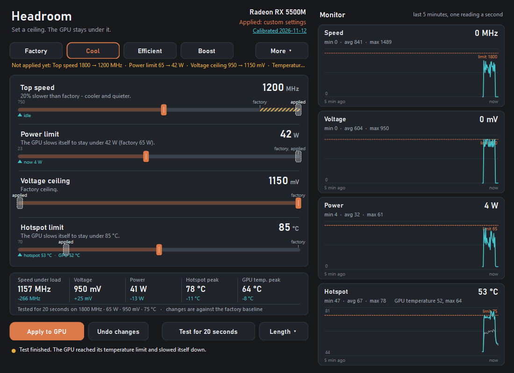

  

<h1 align="center">Headroom</h1>

<b>Set a ceiling. Your GPU stays under it.</b> 
Speed, power, voltage and temperature limits for Radeon RX 5000 GPUs, even when AMD Software hides them.

## What it does

On many Radeon laptops, AMD Software has no tuning page. Headroom gives you one:

- **Four limits:** top speed, power, voltage and hotspot temperature.
- **One click to apply**, plus a **load test** to check the result.
- **Live graphs** that show what the GPU is actually doing.
- **Presets** (Factory, Cool, Efficient, Boost) and your own saved profiles.
- **Calibration**, which tests your GPU and tunes the presets for it.

It's safe to undo. Headroom never flashes anything. Choose **Factory** and everything goes back to normal.

## Will it work on my PC?

| GPU | Status |
| --- | --- |
| RX 5500M | ✅ Tested |
| Other RX 5000 cards (5300M, 5600M, 5700M, 5500 XT, 5600 XT, 5700) | ⚠️ Should work, not yet tested. [Tell us how it goes.](docs/SUPPORTED-GPUS.md) |
| RX 6000 and newer, integrated graphics, Nvidia, Intel | ❌ Not supported |

You need **Windows 10 (version 2004 or newer) or Windows 11, 64-bit**.

## Get started

1. Download `Headroom.exe` and `Reset-to-factory.cmd` from **Releases** and put them in a folder of their own.
2. Run `Headroom.exe`. It asks for administrator rights. SmartScreen may warn you, because the exe isn't signed.
3. **Recommended:** save your GPU's vBIOS with [GPU-Z](https://www.techpowerup.com/gpuz/) (the arrow next to
   *BIOS Version* → *Save to file*). Then load it in Headroom with **More ▾ → Import vBIOS file**. This gives
   Headroom your card's true factory limits.

## How to use it

1. **Pick a preset** or drag a slider.
2. **Press Apply to GPU.** The screen will flicker while the GPU restarts. Close games and other GPU apps first.
3. **Press Test** to see the new speed, power and temperatures, compared with before.

| Preset | What it does |
| --- | --- |
| **Factory** | Your GPU's stock settings |
| **Cool** | Quieter and cooler, a bit slower |
| **Efficient** | Lower voltage at almost the same speed |
| **Boost** | A little faster, and hotter. Test it before you rely on it. |

The full guide, covering calibration, settings, the command line and measured results, is in
**[docs/GUIDE.md](docs/GUIDE.md)**.

## Something went wrong?

Apply **Factory**, or run `Reset-to-factory.cmd`. If Windows won't start normally, follow
[docs/RECOVERY.md](docs/RECOVERY.md). It takes one registry delete from Safe Mode.

## Good to know

- Each change restarts the GPU, so apps using it may crash. Headroom warns you first.
- Updating the AMD driver clears your settings, so apply your preset again afterwards.
- Power, voltage and temperature limits can only go *down* from factory. Only top speed can go up.
- There's no fan control. The laptop handles its own fans.

> **Use at your own risk.** Too much speed or too little voltage can crash games or the driver.
> Headroom gives you a test and a reset, but it can't make every setting safe on every machine.

## More

- [User guide](docs/GUIDE.md): every feature, explained
- [Supported GPUs](docs/SUPPORTED-GPUS.md): how to report your card
- [How it works](docs/HOW-IT-WORKS.md): the technical details, for developers
- [Recovery](docs/RECOVERY.md): how to undo everything

**Build it yourself:** run `build.cmd`. It uses the C# compiler that comes with Windows, so there's nothing to
install.

**Credits:** the table layout comes from the Linux `amdgpu` driver, and the registry approach comes from
MorePowerTool by igor'sLAB. Headroom isn't affiliated with AMD. [MIT licence](LICENSE).
