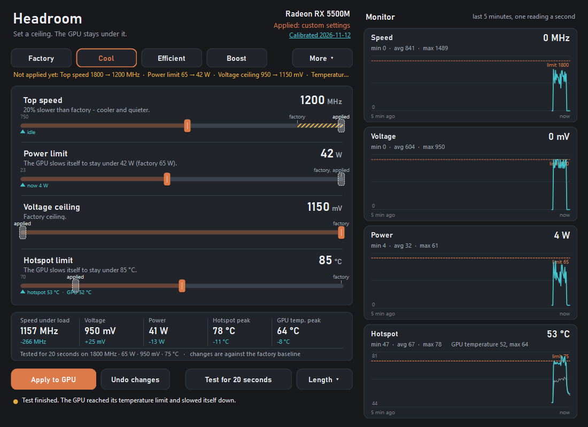
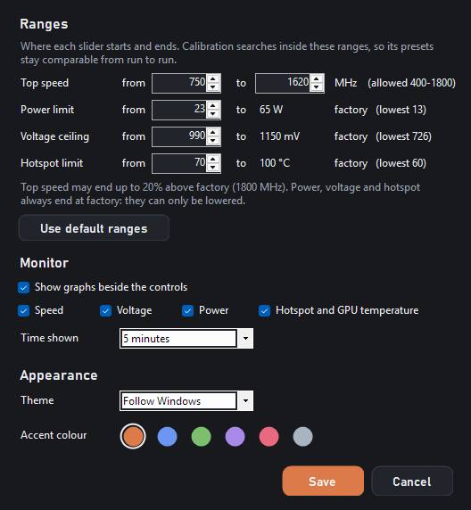

# User guide

- [The main window](#the-main-window)
- [Presets](#presets)
- [Testing](#testing)
- [Calibration](#calibration)
- [Settings](#settings)
- [Command line](#command-line)
- [Limitations](#limitations)
- [Measured results](#measured-results)

## The main window



There are four sliders, one for each limit:

| Limit | What it caps |
| --- | --- |
| **Top speed** | The highest clock speed (MHz) |
| **Power limit** | How much power the GPU can draw (W) |
| **Voltage ceiling** | The highest voltage (mV). Lower means cooler, but too low is unstable. |
| **Hotspot limit** | The temperature where the GPU starts slowing down (°C) |

On each slider:

- The **copper stop** is the limit. Drag it, use the arrow keys, or scroll the mouse wheel.
  Double-click or press Esc to put it back.
- The **teal marker** is the live reading, so you can see how close the GPU is to the limit.
- A **dashed outline** means you've moved the stop but haven't applied it yet. The amber line above the
  sliders lists every pending change.

Nothing reaches the GPU until you press **Apply to GPU**.

**Hotspot vs GPU temperature.** AMD GPUs report two temperatures. *GPU temperature* is the average across the
chip. *Hotspot* is its hottest point, and it runs well above the average. The limit works on the hotspot, so
the GPU can slow down even when GPU temperature looks fine. Headroom shows both.

**Graphs.** The panel on the right plots speed, voltage, power and temperatures over the last 1, 5 or 15
minutes, with your limit drawn as a dashed line. A line pressed flat against its limit is what's holding the
GPU back. You can hide the panel under **More ▾**.

## Presets

| Preset | What it sets |
| --- | --- |
| **Factory** | Removes Headroom's changes. The GPU uses its stock settings. |
| **Cool** | Top speed −20%, power −36%, hotspot limit −15 °C |
| **Efficient** | Voltage −62 mV (or the value calibration found), power −14%, hotspot limit −5 °C |
| **Boost** | Top speed +5% (or the value calibration found). Runs hotter. |

To save your own preset, set the sliders and choose **More ▾ → Save these settings as a profile**. Saved profiles appear in the same menu.

## Testing

Press **Test** to put a heavy load on the GPU and measure the result. Use **Length ▾** to pick 20 seconds, or
1, 3 or 10 minutes. A short test catches crashes. A long test shows where the temperature settles.

The test shows average speed, voltage, power and peak temperatures, and compares them with your last test or
with Factory. It also checks the GPU's maths: if the answers come out wrong, the setting is unstable and the
test fails.

The test always runs on the **applied** settings, not on sliders you've moved but haven't applied.

## Calibration

Until you calibrate, Efficient and Boost use the rough values above. Calibration replaces them with values
measured on your GPU. Click **Not calibrated** at the top right (or use **More ▾**).

It runs a series of tests:

1. **Factory test.** If this fails, calibration stops and changes nothing.
2. **Voltage.** Lowers the voltage 24 mV at a time until a test fails or speed drops by more than 3%. The
   lowest good value becomes **Efficient**.
3. **Speed.** Raises the top speed 2% at a time until a test fails, the hotspot reaches its limit, or the
   extra clock stops helping. The highest good value becomes **Boost**. If a test failed, Boost is set one
   step lower.

**Before you start:** plug the laptop in and close games and other GPU apps. The fans will get loud, and a
failing step may briefly reset the graphics driver. That's expected, and the driver recovers.

Your settings are put back when calibration ends or when you stop it. If the PC crashes partway through,
they're restored at your next sign-in. **More ▾ → Forget calibration** undoes it.

With 20-second tests on a warm laptop, the result is cautious about speed. Choose a longer test length for
presets that hold up under long gaming sessions.

## Settings

Open **More ▾ → Settings**.



- **Ranges.** Where each slider starts and ends. Top speed can go up to 20% above factory. Power, voltage and
  hotspot can never go above factory, but you choose how far down they go. Calibration stays inside these
  ranges.
- **Monitor.** Which graphs to show and how far back they go.
- **Appearance.** Light, dark or match Windows, and one of six accent colours.

## Command line

```
Headroom.exe --status            show what's set and what the GPU reports (changes nothing)
Headroom.exe --apply Cool        apply a preset or saved profile by name
Headroom.exe --calibrate 60      calibrate, with 60 seconds per test
Headroom.exe --reset             go back to factory
Headroom.exe --import gpu.rom    load a vBIOS file
Headroom.exe --theme dark        force the dark or light look
```

`--apply` works well in a desktop shortcut.

## Limitations

- **Every change restarts the GPU.** The driver only reads the settings when it starts.
- **Driver updates clear your settings.** Apply your preset again afterwards.
- **Only top speed can go above factory.** That's on purpose.
- **No fan control.** The laptop controls its own fans.
- **It doesn't unlock the tuning page** in AMD Software.

**Why import the vBIOS?** Without it, Headroom takes its starting point from whatever table is already in the
registry. If you used MorePowerTool before, that table includes your old edits, and Headroom would treat them
as "factory". Only import a vBIOS saved from the GPU in *this* PC.

## Measured results

RX 5500M (MSI Bravo 15), AMD Software 26.10.1, 15–40 second load:

| Setting | Speed | Voltage | Power | Hotspot |
| --- | --- | --- | --- | --- |
| Baseline (1500 MHz, 70 W, 962 mV, 100 °C) | ~1440 MHz | 925 mV | ~55 W | 84–88 °C |
| Top speed 1200 MHz | ~1145 MHz | 825 mV | ~37 W | ~69 °C |
| Power limit 45 W | ~1295 MHz | ~870 mV | 44–45 W | ~76 °C |
| Voltage ceiling 900 mV | ~1410 MHz | 900 mV | ~51 W | ~86 °C |
| Hotspot limit 80 °C | 1170–1440 MHz | varies | 38–54 W | 78–81 °C |
| Top speed 1580 MHz | ~1520 MHz | 962 mV | 62–67 W | 94 °C |

The reported speed always sat about 4% below the number set. The 1580 MHz run lasted only 15 seconds.

A first calibration run on this laptop took under 4 minutes with 20-second tests. Voltage passed down to
890 mV at full speed. Speed passed at 1530 MHz, and 1560 MHz didn't pass.
